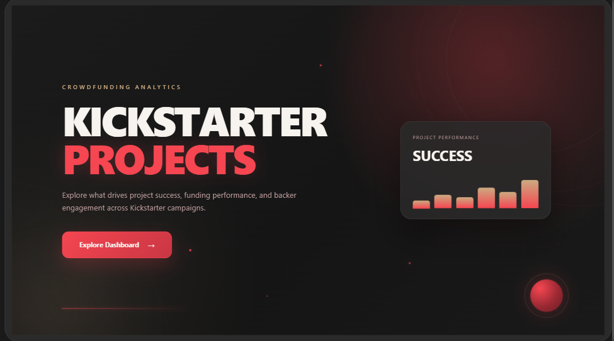
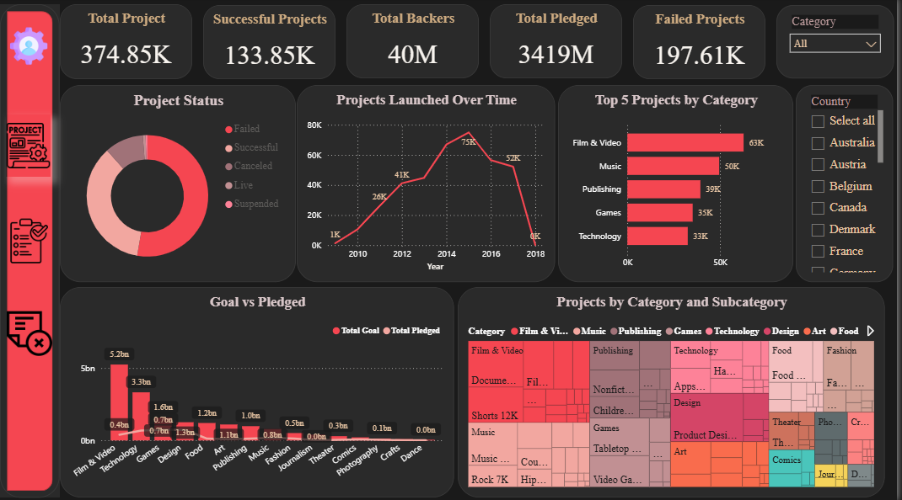
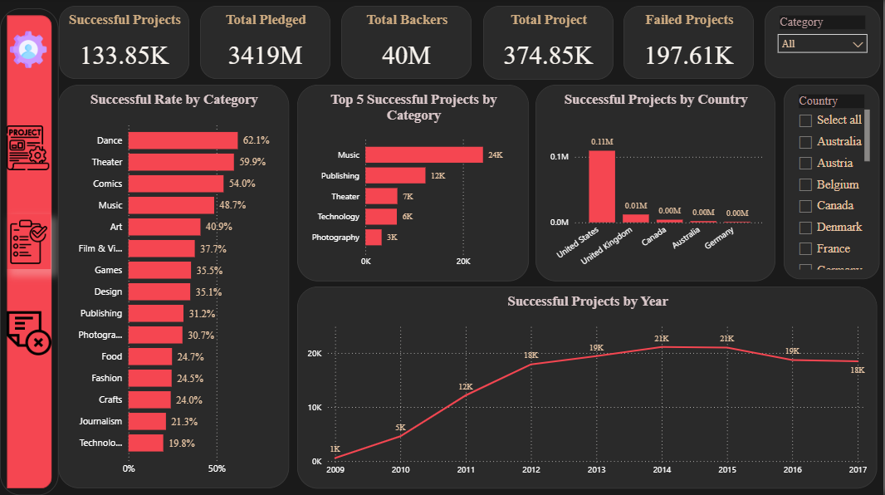
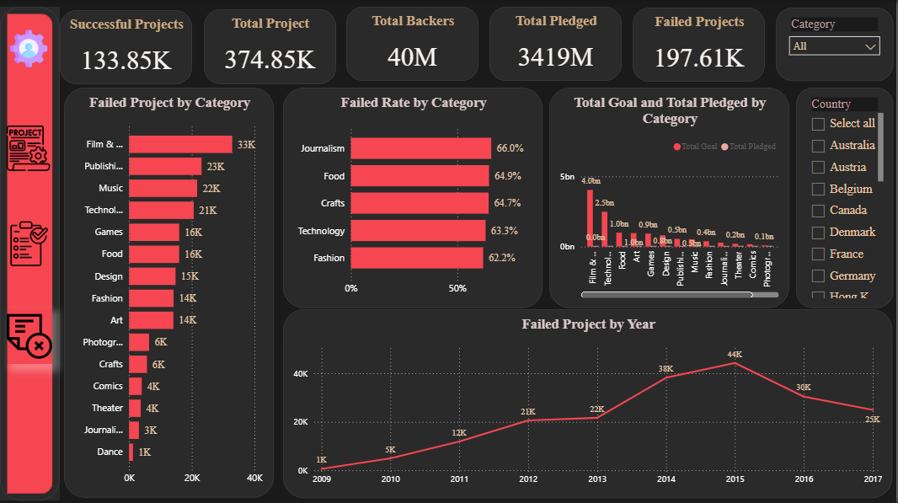

# 🚀 KickStarter Project — Power BI Dashboard

## 🖼️ Project Cover



> **Note:** The Landing Page above is used as the visual cover for the project.

---

## 📊 Project Overview

An interactive **Power BI dashboard** built to analyze Kickstarter projects and transform project-level data into clear and actionable visual insights.

The project explores project performance, success and failure, categories, countries, backers, funding goals, pledged amounts, and project activity over time.

---

## 🎯 Project Objectives

The main objectives of this project are to:

- Analyze the overall Kickstarter project portfolio.
- Understand successful vs. failed projects.
- Compare project performance across categories and subcategories.
- Analyze project activity over time.
- Compare project goals with pledged amounts.
- Explore project performance by country.
- Build an interactive and user-friendly Power BI report.

---

## 🛠️ Tools & Technologies

- **Power BI Desktop**
- **Power Query** — Data Cleaning & Transformation
- **DAX** — Measures & Calculations
- **Data Visualization** — KPIs, charts, slicers, and interactive visuals

---

## 📑 Dashboard Pages

### 🏠 Over View

The **Over View** page works as the landing page and navigation hub of the report.

---

### 📌 Executive Dashboard

Provides a high-level overview of Kickstarter performance, including:

- Total Projects
- Total Backers
- Successful Projects
- Failed Projects
- Total Pledged
- Project Status Distribution
- Category & Subcategory Analysis
- Projects Launched Over Time
- Goal vs. Pledged Analysis
- Country Filtering



---

### ✅ Successful Project

Focuses on successful Kickstarter projects and analyzes their performance across categories, countries, and time.



---

### ❌ Failed Project

Analyzes failed Kickstarter projects and explores patterns across categories, countries, and time.



---

## 📈 Key Analysis Areas

### Project Status

Comparison between successful and failed Kickstarter projects.

### Category Analysis

Analysis of project volume and performance across different categories and subcategories.

### Time Analysis

Tracking project activity over time to identify trends and changes in project launches.

### Funding Analysis

Comparison between the project **Goal** and the actual **Pledged** amount.

### Country Analysis

Exploration of project performance across different countries.

---

## 🧠 Skills Demonstrated

This project demonstrates practical skills in:

- Data Analysis
- Data Cleaning
- Power Query
- DAX
- Data Modeling
- KPI Development
- Data Visualization
- Dashboard Design
- Interactive Reporting
- Business Data Storytelling

---

## 📂 Repository Structure

```text
KickStarter-Project/
│
├── KickStarter_Project.pbix
├── README.md
│
└── Screenshots/
    ├── Landing_Page.png
    ├── Executive_Dashboard.png
    ├── Successful_Project.png
    └── Failed_Project.png
```

---

## 🚀 How to Use

1. Download the `.pbix` file.
2. Open it using **Power BI Desktop**.
3. Start from the **Over View** landing page.
4. Use the navigation buttons to explore the dashboard.
5. Interact with the slicers and visuals to analyze the data.

---

## 👤 Author

**Omar Mosaad**

Data Analyst | Power BI | Excel | Python